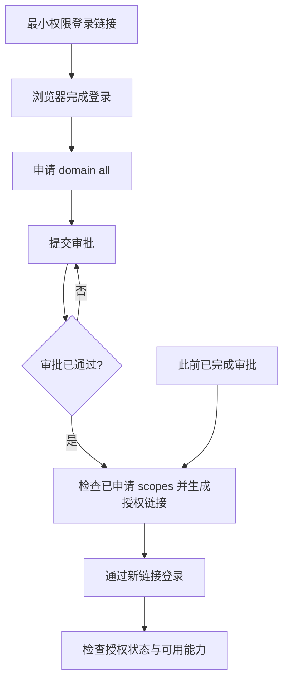

# 飞书 CLI 登录与授权流程

公开同步快照：2026-10-15。保留原文工作方法；附件与企业依赖的调整见文末。

[返回项目目录](../README.md)

适用于 Codex 连接飞书 CLI 时反复登录失败、授权范围不足或授权状态未生效的场景。

**处理原则：**先检查已有登录与实际缺失权限，只申请任务所需权限。下文保留的是曾经明确需要 `domain all` 时的历史流程，不是通用默认步骤；只有使用者明确要求广泛能力并完成组织审批时才适用。命令参数以当前已安装 CLI 的 `auth --help` 为准。本文流程无需二维码。

## 处理流程



### 1. 生成最小权限登录请求

向 Codex 发送以下内容：

```text
请以用户身份发起飞书 CLI 最小权限登录：执行 lark-cli auth login --scope offline_access --no-wait --json。仅申请 offline_access，用于离线刷新并建立当前 CLI 的用户登录态；不要使用 --domain，不要申请任何业务 scope 或 domain all，不要生成二维码。请将 JSON 中的 verification_url 原样发给我，并保留 device_code；在我回复“已完成授权”前不要继续轮询或执行 --device-code。
```

Codex 会返回登录链接。此阶段只处理登录与离线刷新，不申请业务权限。

### 2. 通过链接完成登录

在浏览器打开上一步返回的链接，使用需要授权的飞书账号完成登录。完成后回到 Codex。

### 3. 可选：已明确授权时申请 `domain all` 权限

向 Codex 发送以下内容：

```text
请为当前已登录的飞书用户发起 domain all 权限申请：执行 lark-cli auth login --domain all --no-wait --json。不要生成二维码；请将 JSON 中的 verification_url 原样发给我，用于在浏览器提交授权审批。不要在本轮执行 --device-code。
```

Codex 会生成用于提交权限审批的链接。

### 4. 通过链接提交审批

打开授权链接，按页面提示提交审批。此步骤通常需要等待应用管理员或组织管理员通过。

### 5. 审批通过后，重新生成授权链接

确认审批已经通过后，向 Codex 发送以下内容：

```text
请先执行 lark-cli auth status --json --verify，列出当前用户身份已生效的 scopes。确认 domain all 审批已通过后，执行 lark-cli auth login --domain all --no-wait --json 生成新的授权链接；不要生成二维码。请把 verification_url 原样发给我，并保留 device_code，等我回复“已完成授权”后再完成登录。
```

这一步用于核对当前已申请的 scopes，并生成与审批结果匹配的新授权链接。

### 6. 通过新链接登录

打开第 5 步生成的授权链接，使用同一目标飞书账号完成登录。授权完成后返回 Codex。

### 7. 验收授权状态

向 Codex 发送以下内容：

```text
请执行 lark-cli auth status --json --verify，检查当前用户登录是否有效，并完整列出已生效的 scopes、所属身份和可访问的飞书业务能力；同时说明仍缺少或尚未生效的权限。
```

Codex 应说明当前登录身份、授权是否有效，以及已经可以执行的飞书能力范围。

## 审批已完成时的快捷路径

如果此前已经完成过审批，可跳过第 3、4 步，直接从第 5 步开始：先检查已申请 scopes，再生成新的授权链接。

## 完成标准

Codex 能确认当前飞书登录身份与授权状态有效。

Codex 能列出当前可用的飞书能力或资源范围。

后续飞书 CLI 操作不再反复要求登录或返回授权不足。

## 仍无法登录时的排查

| 现象 | 处理方式 |
|---|---|
| 授权链接已失效 | 重新发送对应步骤中的指令，让 Codex 生成新的链接。 |
| 审批刚通过但仍无权限 | 从第 5 步重新检查 scopes 并生成新授权链接；不要继续使用旧链接。 |
| 登录后仍循环要求登录 | 确认浏览器登录的是目标飞书账号与组织；再按第 1 步和第 5 步重新完成一次授权流程。 |
| Codex 无法说明可用能力 | 发送第 7 步验收指令，要求其检查授权状态并列出当前可执行事项。 |

维护建议：每次重新授权都使用 Codex 当次生成的新链接，避免复用过期链接。

