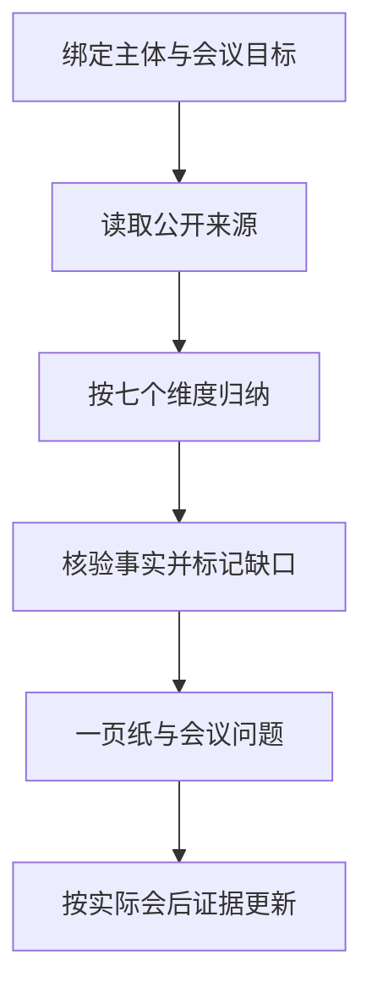

# 会前企业背调 SOP｜脱敏案例 A

公开同步快照：2026-10-15。脱敏方法版：保留研究框架与操作方法；真实主体、人员、联系路线、商业条款、内部记录及可反向识别的组合细节不公开。本文不是原文逐字副本，也不证明任何真实公司的现状。

[返回项目目录](../README.md)

## 使用目标

会前形成可验证的一页企业背景，而不是堆叠网页摘要。每项结论应能回到来源；缺失信息转为会议问题。

## 操作顺序

1. 绑定目标主体、官网、区域、会议目的，排除同名企业。
2. 阅读官网业务、产品、品牌、服务、网点及团队页面。
3. 按七个维度归纳：公司身份、业务模式、产品组合、终端客户、区域覆盖、服务能力、关键角色。
4. 用官方登记、品牌渠道页或其他可信公开来源核对重要事实。
5. 区分当前事实、历史事实、推断与未知，保存来源和核验日期。
6. 输出一页结论、优先问题和下一步，不未经授权直接触达。

## 一页纸模板

| 模块 | 内容 |
|---|---|
| 对方是谁 | 法律主体、业务定位、区域，未知项留空 |
| 为什么值得谈 | 与目标产品及客户场景的匹配证据 |
| 可能的冲突 | 品牌、服务投入、区域或商业条件 |
| 与谁谈 | 当前岗位已确认的角色；不猜汇报关系 |
| 本次要确认 | 需求、决策过程、试点与服务分工 |
| 会后动作 | 负责人、交付物、时间、验收证据 |

截图只用于内部佐证。公开分享时使用结构化空白模板，不包含客户页面、浏览器账户或内部沟通截图。

